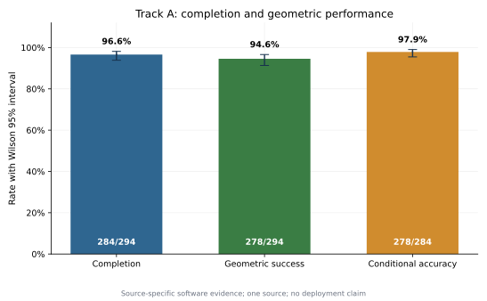
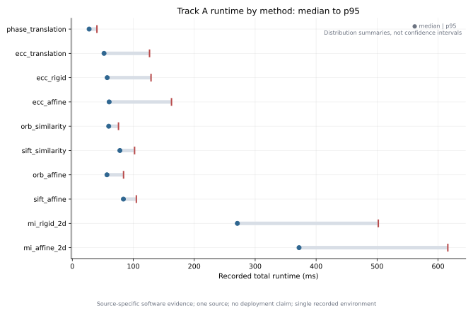
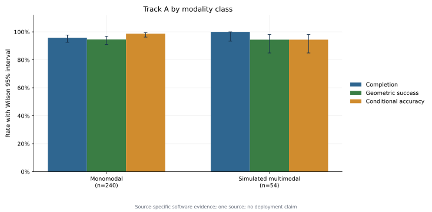
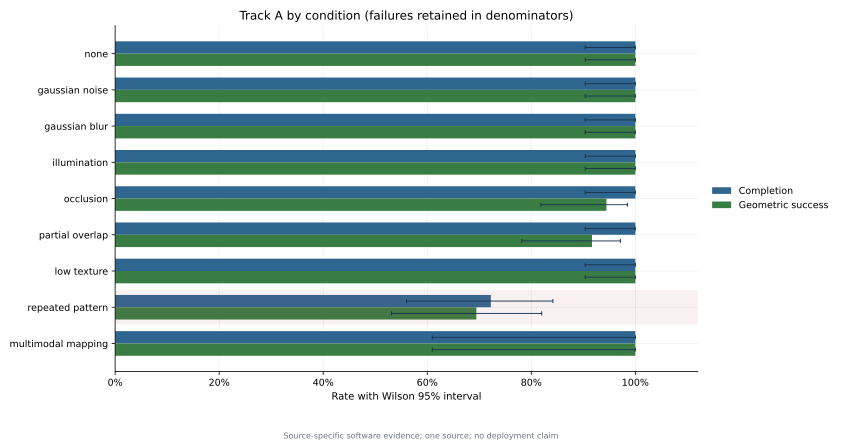
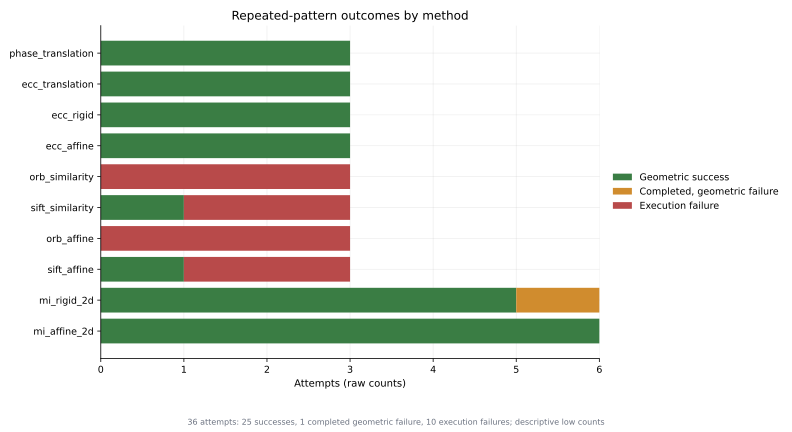
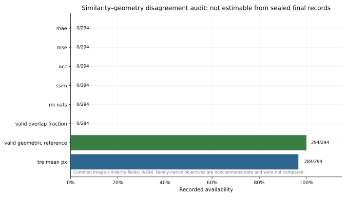
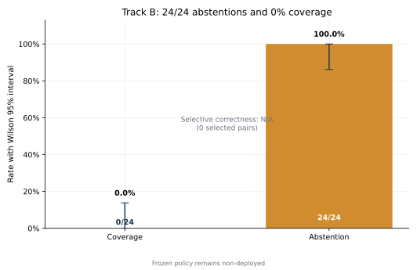

# Week 8 Phase 9.2 final analysis

**Status:** Superseded for confirmatory use by a scientific-review nonconformance finding; G8 blocked.

This report summarizes the sealed Phase 8 evidence. It does not rerun registration or evaluation, open source pixels, prepared arrays, or sealed labels, change frozen thresholds or policy, or compare noncommensurate method-family objectives.

> **Scientific-review erratum (16 November 2026):** The evaluator inherited `z=1.96` instead of passing the frozen Wilson quantile `1.959963984540054`. Scientific review also found two uncaptured frozen secondary endpoints, two recommendation-integrity checks that were not evidence-derived, and incomplete mandatory-stratum/McNemar reporting. Under the maintained post-label defect rule, this run is invalid for preregistration-conformant confirmatory claims. Counts, point estimates, terminal outcomes, and the non-deployed policy decision are unchanged. See the [full finding and consequence](WEEK08_PHASE9_SCIENTIFIC_REVIEW_FINDING.md) and the [versioned interval/reporting supplement](../reports/week08_phase9_review_tables/). The original Phase 9.2 tables and figures below remain immutable historical evidence; their interval endpoints are superseded by the erratum table.

## Evidence and claim boundary

- 150 prepared pairs, 294 preregistered compatible Track A attempts, and 24 Track B policy-eligible pairs were reconciled.
- The evidence comes from one independently enrolled source with synthetic-after-freeze ground truth.
- Claims are restricted to source-specific, non-confirmatory software evidence.
- The results do not support anatomical, clinical, modality-wide, population, external-validity, or cross-source generalization.

## Track A completion and geometric success

| Endpoint | Result | Wilson 95% CI |
|---|---:|---:|
| Execution completion | 284/294 (96.60%) | 93.85%-98.14% |
| Geometric success | 278/294 (94.56%) | 91.34%-96.62% |
| Conditional accuracy | 278/284 (97.89%) | 95.47%-99.03% |
| Scientific infrastructure incidents | 0/294 (0%) | 0%-1.29% |

There were ten execution failures and six completed attempts that did not meet the frozen geometric-success criterion.

The Wilson intervals are attempt-level descriptive intervals. Because the attempts are correlated within one source, they do not represent independent-source uncertainty. The displayed two-decimal bounds happen to be unchanged by the quantile correction, but the six-decimal historical endpoints are superseded by the [Wilson interval erratum](../reports/week08_phase9_review_tables/wilson_interval_erratum.csv).



Data: [Track A overall table](../reports/week08_phase9_tables/track_a_overall.csv)

## Runtime and uncertainty

Recorded total runtime across all 294 attempts had a median of 80.506 ms, a mean of 166.499 ms, a p95 of 460.809 ms, and a range of 15.834-1352.326 ms.

| Method | Median (ms) | p95 (ms) |
|---|---:|---:|
| Phase Correlation | 27.584 | 40.383 |
| ECC Translation | 52.035 | 126.704 |
| ORB + RANSAC Affine | 56.832 | 84.069 |
| ECC Rigid | 57.236 | 129.151 |
| ORB + RANSAC Similarity | 59.707 | 75.776 |
| ECC Affine | 60.433 | 162.744 |
| SIFT + RANSAC Similarity | 78.023 | 102.160 |
| SIFT + RANSAC Affine | 83.824 | 105.058 |
| Mattes MI Rigid 2D | 270.767 | 502.041 |
| Mattes MI Affine 2D | 371.981 | 616.037 |

These values are total recorded runtimes from one environment. Median and p95 are distribution summaries, not confidence intervals. Method-only runtime was unavailable for 294/294 attempts, despite being a frozen endpoint; this is preregistration nonconformance, not merely an ordinary limitation.



Data: [runtime table](../reports/week08_phase9_tables/track_a_runtime_by_method.csv)

## Monomodal and simulated-multimodal results

| Modality class | Completion | Geometric success | Conditional accuracy | Median / p95 runtime |
|---|---:|---:|---:|---:|
| Monomodal | 230/240 (95.83%) | 227/240 (94.58%) | 227/230 (98.70%) | 69.531 / 451.568 ms |
| Simulated multimodal | 54/54 (100%) | 51/54 (94.44%) | 51/54 (94.44%) | 334.363 / 551.044 ms |

The Wilson 95% intervals were 92.50%-97.72%, 90.95%-96.81%, and 96.24%-99.56% for monomodal completion, geometric success, and conditional accuracy. For simulated multimodal cases, they were 93.36%-100% for completion and 84.89%-98.09% for both geometric success and conditional accuracy.

These strata differ in compatible methods and case composition, so the comparison is descriptive rather than evidence of a causal modality effect.



Data: [modality table](../reports/week08_phase9_tables/track_a_by_modality.csv)

## Condition-specific behavior

Gaussian blur, Gaussian noise, illumination, low texture, and the clean condition each had 36/36 completion and 36/36 geometric success. Simulated multimodal mapping had 6/6 completion and success.

| Condition | Completion | Geometric success |
|---|---:|---:|
| Occlusion | 36/36 (100%) | 34/36 (94.44%; 81.86%-98.46%) |
| Partial overlap | 36/36 (100%) | 33/36 (91.67%; 78.17%-97.13%) |
| Repeated pattern | 26/36 (72.22%; 56.01%-84.15%) | 25/36 (69.44%; 53.14%-82.00%) |

Condition labels identify associated test stresses, not proven failure causes.



Data: [condition table](../reports/week08_phase9_tables/track_a_by_condition.csv)

## Repeated-pattern failures

Repeated-pattern cases produced all ten execution failures: six `insufficient_filtered_matches` and four `insufficient_ransac_inliers`. Of the 26 completed repeated-pattern attempts, 25 were geometrically successful, giving conditional accuracy of 96.15% (Wilson 95% CI 81.11%-99.32%). The main loss therefore came from feature-correspondence/RANSAC execution failures, with one additional completed geometric failure.



Data: [repeated-pattern table](../reports/week08_phase9_tables/repeated_pattern_by_method.csv)

## Similarity-versus-geometric disagreement

**Status: `NOT_EVALUABLE_FROM_SEALED_FINAL_RECORDS`.**

Common post-registration MAE, MSE, NCC, SSIM, mutual-information, and valid-overlap values were available for 0/294 attempts. Valid geometric references were available for 294/294 attempts, and numeric TRE was available for 284/294. Because `valid_overlap_fraction` was a frozen secondary endpoint, its 0/294 availability is also preregistration nonconformance; it must not be calculated retroactively from the revealed holdout.

Family-native diagnostics exist for all attempts: ECC values for 72, Mattes MI values for 102, phase response for 24, and feature/RANSAC diagnostics for 96. Those objectives are not commensurate, and the frozen protocol prohibits treating them as a shared similarity scale. Consequently, the disagreement rate is unavailable, not zero. Computing new common similarity values after label access would be an unregistered post-label analysis.



Data: [similarity-geometry availability table](../reports/week08_phase9_tables/similarity_geometry_availability.csv)

## Track B policy result

The frozen policy abstained on all 24 eligible pairs.

| Endpoint | Result | Wilson 95% CI |
|---|---:|---:|
| Coverage | 0/24 (0%) | 0%-13.80% |
| Abstention | 24/24 (100%) | 86.20%-100% |
| Selective correctness | Undefined | Not applicable |

Every represented condition had 3/3 abstentions. With no selected pairs, selective correctness is undefined rather than zero. The policy remains non-deployed.



Data: [Track B policy table](../reports/week08_phase9_tables/track_b_policy.csv)

## Limitations

1. One independent source provides no independent source replication or external validity.
2. Synthetic-after-freeze ground truth supports source-specific software testing, not anatomical or clinical conclusions.
3. The 294 attempts are correlated cases from one source and are not 294 independent source samples.
4. Runtime describes one recorded environment only.
5. Common similarity evidence was not sealed, so similarity-versus-geometry disagreement cannot be estimated.
6. Track B made no selections, so selective correctness cannot be measured.
7. The evaluator used `z=1.96` rather than the frozen `1.959963984540054`; the corrected six-decimal intervals are versioned separately.
8. Method-only runtime and valid-overlap endpoints were absent for all 294 attempts.
9. Recommendation integrity/post-label checks were not evidence-derived, although four quantitative gates independently preserve non-deployment.
10. The original Phase 9.2 package omitted mandatory strata, TRE endpoint distributions, and nine exact-McNemar comparisons; the versioned supplement publishes them without restoring confirmatory validity.

## Reproduction

Run:

```powershell
.venv\Scripts\python.exe -B scripts\week08_phase9_final_analysis.py --check
.venv\Scripts\python.exe -B scripts\week08_phase9_scientific_review_audit.py --check
```

The first command privately rebuilds the historical aggregate tables and SVG figures and verifies every tracked byte against the sealed evidence and the [Phase 9.2 manifest](../reports/week08_phase9_final_analysis.json). The second independently reproduces the scientific-review finding and the five versioned supplement tables. Neither command executes registration or evaluation.

## Review and next step

The automated scientific audit failed and release review is blocked; no named human approval has been recorded. G8 cannot close on this run. The next compliant work is a new evaluation cycle: correct and test the evaluator and evidence-derived integrity gates before a new G5 freeze, then enroll a newly reserved, unexposed holdout through renewed G6/G7 review. The frozen historical artifacts and non-deployed policy remain unchanged.
